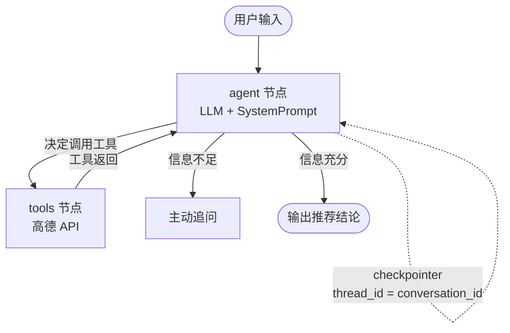

# 🧭 出行决策 Agent（LangGraph 版）

神经网络与机器学习课程期末作业。用户输入当前位置和品牌偏好，Agent 调用高德地图检索附近商场、核对品牌门店、比较距离，给出推荐结论，支持多轮追问。

**技术框架：LangGraph**（ReAct 循环 + 工具调用 + 会话记忆），部署在 EdgeOne Makers。
本项目 Fork 自 `TencentEdgeOne/openai-agent-starter-python`，沿用其 Makers 运行规范，把示例的天气/翻译工具替换成了高德出行决策工具。

---

## 一、两套入口，同一份 Agent 逻辑

核心逻辑只有一份：`agents/_travel/`。两个入口共用它，互不重复。

| 入口 | 用途 | 怎么跑 |
| --- | --- | --- |
| `agents/chat/index.py` | **线上**（EdgeOne Makers）。路径自动映射为 `POST /chat`，输出 SSE | 平台托管，构建命令 `npm run build` |
| `app.py` + `static/index.html` | **本地调试**。FastAPI 提供页面和 `/api/chat`（NDJSON 流） | `uvicorn app:app --port 8000` |

> ⚠️ 不要给 `edgeone.json` 加 `runtime` / `entry` / `startCommand`。
> Makers 不会帮你启动一个长驻的 uvicorn 服务，加了也跑不起来。

---

## 二、项目结构

```
travel-decision-agent/
├── agents/
│   ├── chat/index.py           # 【线上入口】Makers handler → POST /chat（SSE）
│   ├── chat/stop.py            # POST /chat/stop，中断生成
│   ├── _logger.py              # 日志工具（下划线开头=私有，不映射路由）
│   └── _travel/                # ★ 出行决策核心（单一真源）
│       ├── config.py           # 环境变量读取（密钥唯一入口）
│       ├── amap.py             # 高德 Web 服务封装（含球面距离兜底）
│       ├── tools.py            # 4 个 LangGraph 工具
│       ├── prompts.py          # 系统提示词与业务规则
│       └── graph.py            # LangGraph 图 + checkpointer + 事件流
├── cloud-functions/            # 无状态云函数：/history、/conversations 等
├── src/                        # React + Vite 前端（i18n 已改为出行决策主题）
├── app.py                      # 【本地入口】FastAPI 调试用
├── static/index.html           # 本地调试页面
├── edgeone.json                # 部署配置（沿用 starter，勿改 runtime）
├── requirements.txt
└── tests/                      # 三套测试，均不需真实密钥
```

---

## 三、LangGraph 架构



核心只有一句：

```python
_graph = create_react_agent(llm, tools=TOOLS, prompt=SYSTEM_PROMPT, checkpointer=InMemorySaver())
```

- 线上：`thread_id` 取 `context.conversation_id`，所以同一会话能连续追问。
- 后端推给前端的事件带**两个名字**：`name` 是英文原名（前端按它匹配图标），`label` 是中文名（直接展示）。

---

## 四、功能对照课程要求

| 课程要求 | 实现位置 | 说明 |
| --- | --- | --- |
| 根据位置检索附近商场 | `agents/_travel/tools.py` → `search_nearby_malls` | 高德 `/v3/place/around`，商场 POI 类型 + 关键词双路检索 |
| 获取距离、店铺信息 | `get_route_distance` / `check_brand_in_mall` | 距离支持直线/驾车/步行；品牌按商场坐标 400m 内核对 |
| 结合品牌偏好生成推荐 | `agents/_travel/prompts.py` | 提示词约束：先定位 → 检索 → 核对 → 比距离 → 推荐 |
| 支持多轮、记住上下文 | `agents/chat/index.py` + `graph.py` | `conversation_id` 作 `thread_id`，checkpointer 保存历史 |
| 信息不足时主动追问 | `prompts.py` 硬性规则 | 一次只问一个关键问题，不编造推荐 |
| 工具失败时说明原因 | `tools.py` 每个工具的 try/except | 返回 `{"error": "..."}`，模型据此如实告知 |
| 所有密钥只从环境变量读取 | `agents/_travel/config.py` | `AI_GATEWAY_*`、`AMAP_API_KEY`，代码无明文 |

---

## 五、本地运行

```bash
# 1. 装依赖（网络慢就加镜像）
pip install -r requirements.txt -i https://mirrors.cloud.tencent.com/pypi/simple/

# 2. 配置环境变量
cp .env.example .env       # Windows: copy .env.example .env
# 填入 AI_GATEWAY_API_KEY / AI_GATEWAY_BASE_URL / AMAP_API_KEY

# 3. 启动本地调试入口
uvicorn app:app --reload --port 8000
# 打开 http://127.0.0.1:8000

# 4. 自检（无需真实密钥）
python tests/smoke_test.py            # 冒烟：图 + 工具 + 容错
python tests/test_api_flow.py         # 本地 FastAPI 事件流
python tests/test_makers_handler.py   # 线上 handler 的 SSE 协议
```

`/api/health` 可检查密钥是否就位（只返回 true/false，不返回密钥值）。

**课程测试用例**

- 场景一（信息完整）：`我在红莲南路地铁站附近，我想要去一个既有倍轻松又有西屋的离得近的商场，帮我推荐。`
- 场景二（连续追问）：`如果不要求两个品牌同时存在，还有没有距离更近的选择？`

前端完整体验（`npm run dev`）需要装 Node 依赖，仅本地调试用 `app.py` 即可，不必跑 Vite。

---

## 六、部署到 EdgeOne Makers

1. **Fork**：`TencentEdgeOne/openai-agent-starter-python` → 仓库名 `travel-decision-agent`
2. **绑定**：Makers 控制台 → 授权 Git 平台 → 创建项目 → 选择该仓库
3. **申请高德 Key**：<https://console.amap.com/dev/key/app> → 应用管理 → 添加 Key → **类型选「Web 服务」**
4. **配置环境变量**：
   - 线上：Makers 控制台 → 项目 → 环境变量，填 `AI_GATEWAY_BASE_URL` / `AI_GATEWAY_API_KEY` / `AI_GATEWAY_MODEL` / `AMAP_API_KEY`
   - 本地：写 `.env`（确认 `git check-ignore .env` 有输出）
5. **Push 触发部署**：`git push`
6. **新建部署**：Makers → 部署管理 → 新建部署 → 用临时预览地址验证

> **关于 `actions-success.png`**：本模板不含 `.github/workflows`，构建部署由 Makers 平台完成，
> 因此该项提交 **Makers 构建/部署日志的成功截图**，并在说明中注明「模板无 GitHub Actions，改用 Makers 构建日志」。

### 换模型不用改代码

改环境变量 `AI_GATEWAY_MODEL` 后重新部署即可。

---

## 七、课后提交

```
submission/
├── local-running.png       # 本地调试页面
├── normal-result.png       # 场景一结果
├── follow-up-result.png    # 场景二连续追问
├── actions-success.png     # Makers 构建成功截图（模板无 GitHub Actions）
├── deploy-success.png      # Makers 部署成功
└── public-entry.txt        # 公开预览地址
```

---

## 八、常见问题

| 现象 | 排查 |
| --- | --- |
| 部署失败、找不到入口 | 确认 `agents/chat/index.py` 存在且提供 `async def handler(context)` |
| 本地 8000 打不开 | 看启动日志的实际端口；确认用的是仓库根目录的 `app.py` |
| 回答有地点但没有工具过程 | `AMAP_API_KEY` 是否为「Web 服务」类型 |
| 追问忘记前文 | 线上靠 `conversation_id`，前端别开新会话；本地别改 `thread_id` |
| 距离返回 0 | 驾车/步行可能因道路数据缺失返回 0，已自动退化为球面距离 |
| Windows 中文乱码 | 命令前加 `PYTHONIOENCODING=utf-8` |
| `create_react_agent` 弃用警告 | langgraph 1.x 的正常提示，2.0 才移除，依赖已锁 `<2.0` |

---

## 九、安全提示

- `.env` 已在 `.gitignore` 中，提交前用 `git check-ignore .env` 确认
- 不要把 Key 写进代码、`api-schema.json`、提示词或 Git URL
- `/api/health` 只返回布尔值，不输出任何密钥内容
